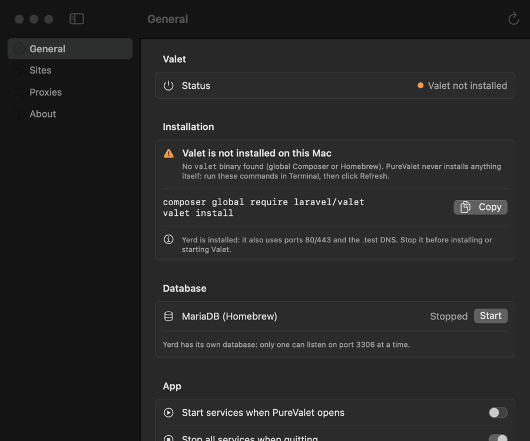

<p align="center">
  <picture>
    <source media="(prefers-color-scheme: dark)" srcset="docs/icon-dark.png">
    
  </picture>
</p>

<h1 align="center">PureValet</h1>

<p align="center">
  Une petite appli macOS native, dans la barre de menus, qui fait tourner tout votre environnement <a href="https://laravel.com/docs/valet">Laravel Valet</a>, sans terminal.<br>
  <a href="README.md">English version</a>
</p>

---

<p align="center">
  
</p>

Valet est l’environnement PHP local le plus léger sur macOS (nginx + PHP-FPM + dnsmasq, sans Docker ni VM), mais il ne s’utilise qu’en ligne de commande et ses services tournent tant qu’on ne les arrête pas. PureValet en fait une appli qu’on ouvre pour travailler et qu’on quitte quand on a fini :

- **On ouvre PureValet → la pile tourne.** Valet (nginx, PHP-FPM, dnsmasq) et MariaDB Homebrew se démarrent depuis le menu, ou automatiquement au lancement.
- **On quitte PureValet → tout s’arrête.** Valet et MariaDB sont arrêtés et désenregistrés de launchd : rien ne tourne en fond, rien ne redémarre avec le Mac.
- **Natif et léger.** SwiftUI, DMG de moins de 1 Mo, universel (Apple Silicon + Intel), aucune dépendance, aucun minuteur, aucun démon.
- **N’installe rien.** Si Valet est absent, PureValet l’affiche et donne la commande à lancer vous-même.
- **Anglais et français.** L’appli suit la langue de macOS.

> Projet communautaire, non affilié à Laravel.

## Interface

Inspirée de [Hex](https://hex.audio) : un menu natif simple pour les actions courantes, et une fenêtre de réglages pour le reste.

- **Menu de la barre de menus** : état, *Tout démarrer* / *Tout arrêter*, Démarrer / Redémarrer / Arrêter Valet, *Sites* (ouvrir, lier ou parquer un dossier), *Proxys*, *PHP global* (coche sur la version active), *Logs et fichiers*, MariaDB, **Réglages… ⌘,**, **Quitter ⌘Q**.
- **Fenêtre de réglages** avec barre latérale :
  - *Général* : état, version du CLI Valet, domaine, dossiers des logs et de la configuration, PHP global, commandes sans mot de passe, MariaDB, comportement de l’appli (démarrage au lancement, arrêt en quittant, ouverture à la connexion).
  - *Sites* : sites liés et parqués, HTTPS, PHP par site, copier l’URL, Finder, Terminal, délier ; dossiers parqués (parquer / oublier).
  - *Proxys* : liste, ajout, suppression.
  - *À propos* : versions de PureValet, Valet, PHP, nginx, dnsmasq, Composer et MariaDB ; mises à jour.

Le logo de la barre de menus est atténué quand Valet est arrêté. Si vous ne le voyez pas (une barre de menus chargée cache des icônes derrière l’encoche), rouvrez PureValet depuis Spotlight ou le Launchpad : la fenêtre de réglages s’affiche. Dans le menu, une **pastille verte** indique que Valet tourne et une **pastille rouge** qu’il est arrêté ; chaque site a aussi sa pastille (verte : il répond, rouge : erreur serveur ou pas de réponse).

Si `valet trust` n’est pas activé, PureValet propose une seule fois de l’activer au lieu de demander votre mot de passe à chaque action.

## Fonctions

| Domaine | Ce que vous pouvez faire | Commande utilisée |
| --- | --- | --- |
| Services | Tout démarrer / arrêter d’un coup, au lancement ou en quittant | `valet start\|stop`, `brew services run\|stop mariadb` |
| Valet | Démarrer, redémarrer, arrêter, voir la version du CLI | `valet start\|restart\|stop`, `valet --version` |
| Sites | Sites liés et parqués : ouvrir, copier l’URL, Finder, Terminal | `valet links`, `valet parked` |
| Lier / Parquer | Lier un dossier, ou parquer un dossier de projets ; l’oublier | `valet link`, `valet park`, `valet forget` |
| HTTPS | Activer / désactiver HTTPS | `valet secure`, `valet unsecure` |
| PHP | Version globale, ou une version par site | `valet use`, `valet isolate`, `valet unisolate` |
| Proxys | Rediriger `nom.test` vers un port local (Node, Vite…) | `valet proxy`, `valet unproxy` |
| Mot de passe | Supprimer les invites de mot de passe | `valet trust` |
| Fichiers | Ouvrir les logs et la configuration de Valet | `~/.config/valet` |
| MariaDB | Démarrer / arrêter MariaDB Homebrew (jamais enregistrée à la connexion) | `brew services run\|stop mariadb` |
| phpMyAdmin | Installer, mettre à jour et ouvrir un phpMyAdmin intégré sur `https://phpmyadmin.test` | version officielle + `valet link/isolate/secure` |

PureValet prévient aussi si Yerd est installé (mêmes ports 80/443, même DNS `.test`, même port 3306).

## Prérequis

- macOS 14 Sonoma ou plus récent
- Homebrew (`/opt/homebrew` ou `/usr/local`)
- Laravel Valet, installé via Composer :

```bash
composer global require laravel/valet
```

```bash
valet install
```

## Installation

### Avec Homebrew (recommandé)

```bash
brew install --cask aubinvan/tap/purevalet
```

Mise à jour ensuite avec `brew upgrade --cask purevalet`.

### Manuellement

1. Téléchargez `PureValet-x.y.z.dmg` depuis la [dernière version](https://github.com/aubinvan/purevalet/releases/latest).
2. Ouvrez-le et glissez **PureValet** dans **Applications**.
3. Premier lancement (dans les deux cas) : l’appli est signée ad hoc mais **pas notarisée** (pas de compte Apple Developer payant), macOS la bloque donc une fois. Lancez-la puis **Réglages Système → Confidentialité et sécurité → Ouvrir quand même**, ou retirez l’attribut de quarantaine :

```bash
xattr -dr com.apple.quarantine "/Applications/PureValet.app"
```

Vérifier le téléchargement avec le fichier `.sha256` joint à la version :

```bash
shasum -a 256 -c PureValet-x.y.z.dmg.sha256
```

## phpMyAdmin

**Réglages → Général → Base de données → phpMyAdmin → Installer…** (ou *Installer phpMyAdmin…* dans le menu) :

1. télécharge la dernière version officielle sur phpmyadmin.net et vérifie son empreinte SHA-256 ;
2. l’installe dans `~/Library/Application Support/PureValet/phpMyAdmin` avec une configuration pour le socket local de MariaDB ;
3. la sert sur `https://phpmyadmin.test`, isolée sur une version de PHP qu’elle prend en charge (par exemple PHP 8.3 si votre PHP global est 8.5).

Connexion avec votre **nom d’utilisateur macOS et un mot de passe vide** : le MariaDB de Homebrew reconnaît votre compte via son socket local (`unix_socket`), aucun mot de passe de base de données n’est donc stocké. *Mettre à jour vers x.y.z* apparaît quand une nouvelle version de phpMyAdmin sort.

## Mises à jour

PureValet vérifie sur GitHub s’il existe une nouvelle version **au plus une fois par jour** (une seule requête, au lancement ou à l’ouverture du menu). Si c’est le cas, l’élément *Télécharger PureValet x.y.z…* apparaît dans le menu, et l’onglet À propos affiche les notes de version et un bouton de téléchargement. Rien n’est téléchargé ni installé sans vous.

- Désactivable dans **Réglages → À propos → Rechercher les mises à jour automatiquement**, ou bouton **Vérifier maintenant**.
- Avec Homebrew : `brew upgrade --cask purevalet`.

## Démarrage et arrêt

Dans **Réglages → Général → Application** :

| Option | Par défaut | Effet |
| --- | --- | --- |
| Démarrer les services à l’ouverture de PureValet | Désactivé | Démarre Valet et MariaDB au lancement |
| Arrêter tous les services en quittant | **Activé** | Arrête Valet et MariaDB quand vous quittez PureValet (ou fermez la session / éteignez le Mac) |
| Ouvrir à la connexion | Désactivé | Ouvre PureValet à l’ouverture de session |

Pourquoi c’est important : `valet start` enregistre nginx, PHP-FPM et dnsmasq auprès de launchd. Sans PureValet, ils continueraient de tourner et redémarreraient à chaque démarrage du Mac. Quitter PureValet les arrête et les désenregistre. MariaDB est démarrée avec `brew services run`, qui ne l’enregistre jamais à la connexion.

## Comptes macOS standard (sans droits admin)

Valet a normalement besoin de `sudo`. Si votre compte macOS est un **compte standard** (recommandé pour la sécurité, avec un compte admin séparé), PureValet passe automatiquement en **mode sans admin** :

- il lance lui-même nginx, PHP-FPM et dnsmasq **sous votre compte**, à partir des fichiers de Valet : jamais de mot de passe administrateur ;
- seul votre Mac peut accéder à vos sites (sans root, nginx doit écouter sur toutes les interfaces, il refuse donc toute autre adresse) ;
- quitter PureValet arrête tout, comme d’habitude.

Une **configuration unique** nécessite un compte administrateur : *Réglages → Général → Compte standard → Configurer une fois…* (macOS demande le nom et le mot de passe admin). Elle dirige `.test` vers le DNS de PureValet, retire les services root de Valet et approuve l’autorité de certification HTTPS de Valet. Ensuite, l’usage quotidien ne demande plus aucun droit admin.

## Mot de passe administrateur (`sudo`)

Valet relance certaines commandes avec `sudo` (start, stop, use, secure, isolate…). L’appli n’a pas de terminal : elle fournit à `sudo` un *askpass*, une boîte de dialogue macOS standard. Le mot de passe va directement à `sudo`, PureValet ne le lit ni ne le garde.

Pour ne plus avoir d’invite (recommandé avec *Arrêter tous les services en quittant*) : **Réglages → Général → Commandes sans mot de passe → Activer…**, qui lance une fois `valet trust`.

## Compiler depuis les sources

Xcode 15.4+ ou les Command Line Tools (Swift 5.10+).

```bash
git clone https://github.com/aubinvan/purevalet.git && cd purevalet
```

```bash
./build.sh
```

```bash
open build/PureValet.app
```

Créer le DMG (dans `build/`, avec son SHA-256) :

```bash
./scripts/make-dmg.sh
```

Lancer les tests et la vérification des traductions :

```bash
swift test
```

```bash
python3 scripts/check-l10n.py
```

Structure du code, traductions et publication : [CONTRIBUTING.md](CONTRIBUTING.md).

## Limites

- Pas notarisée (voir Installation).
- Testée sur Apple Silicon ; la version Intel n’est pas testée.
- `valet share` et Expose ne sont pas gérés.

## Contribuer

Les contributions sont bienvenues : signalements de bugs, idées, traductions, documentation et code.

- Lisez [CONTRIBUTING.md](CONTRIBUTING.md) (installation, méthode de travail, principes) et le [Code de conduite](CODE_OF_CONDUCT.md).
- Questions et idées : [Discussions](https://github.com/aubinvan/purevalet/discussions). Bugs : [issues](https://github.com/aubinvan/purevalet/issues/new/choose). Sécurité : [SECURITY.md](SECURITY.md).
- Les bons points de départ portent l’étiquette [`good first issue`](https://github.com/aubinvan/purevalet/labels/good%20first%20issue).

## Licence

[MIT](LICENSE) : utiliser, copier, modifier, vendre, redistribuer, tout est permis. Seule condition : garder la mention de copyright.
