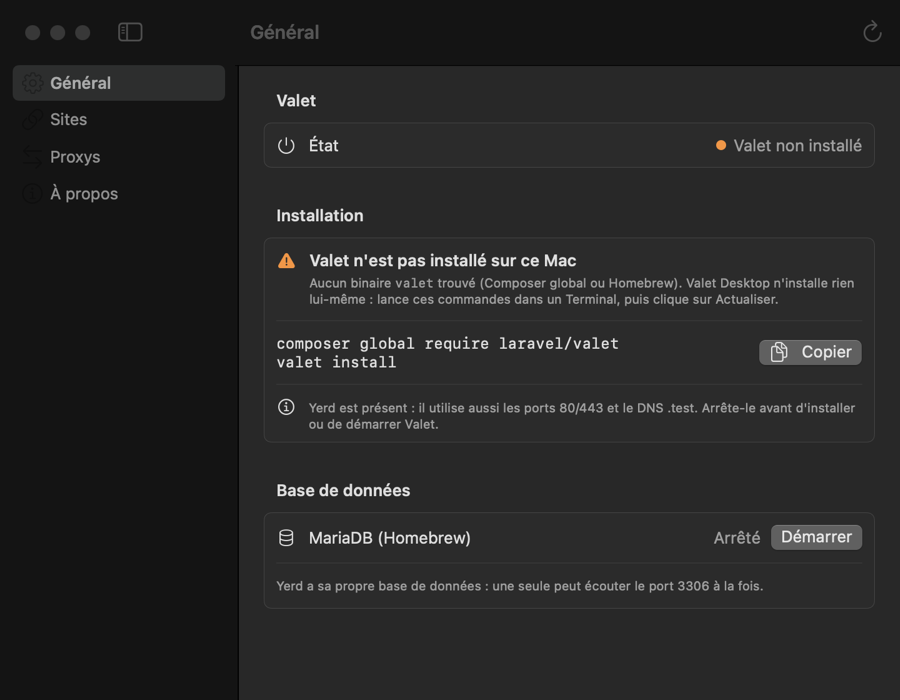

<p align="center">
  
</p>

<h1 align="center">Valet Desktop</h1>

<p align="center">
  A tiny native macOS menu bar app to drive <a href="https://laravel.com/docs/valet">Laravel Valet</a> without the terminal.<br>
  <a href="README.fr.md">Version française</a>
</p>

<p align="center">
  <a href="https://github.com/aubinvan/valet-desktop/releases/latest"></a>
  <a href="https://github.com/aubinvan/valet-desktop/actions/workflows/ci.yml"></a>
  <a href="LICENSE"></a>
</p>

---

<p align="center">
  
</p>

Valet is the lightest local PHP environment on macOS (nginx + dnsmasq + php-fpm, no Docker, no VM), but it only has a CLI. Valet Desktop puts the everyday commands one click away in the menu bar, and stays out of the way:

- **Native SwiftUI**, ~560 KB DMG, universal (Apple Silicon + Intel), no dependencies.
- **Nothing runs in the background.** No timers, no daemon, no helper. State is read when you open the menu or the settings window, and after each action. Quit the app and nothing is left.
- **Installs nothing.** If Valet is missing, the app says so and shows the command to run yourself.

> Valet Desktop is a community project and is not affiliated with or endorsed by Laravel.

## Interface

Inspired by [Hex](https://hex.audio): a plain native menu in the menu bar for everyday actions, and a settings window for the rest.

- **Menu bar menu**: status, Start / Stop Valet, *Sites* (open in browser, link a folder), *Proxies*, *Global PHP* (checkmark on the active version), MariaDB, **Settings… ⌘,**, **Quit ⌘Q**.
- **Settings window** with a sidebar: *General* (status, global PHP, MariaDB, install help), *Sites* (HTTPS, per-site PHP, Finder, unlink), *Proxies* (list, add, remove), *About*. The window is created when you open it and released when you close it.

## Features

| Area | What you can do | Valet / Homebrew command |
| --- | --- | --- |
| Status | See running / stopped / **not installed**, Start / Stop | `valet status`, `valet start`, `valet stop` |
| Sites | List linked sites, open them in the browser, reveal in Finder | `valet links` |
| Link | Pick a folder and link it | `valet link <name>` |
| HTTPS | Secure / unsecure a site | `valet secure`, `valet unsecure` |
| PHP | Switch the global PHP version | `valet use php@X` |
| PHP per site | Isolate a site on a PHP version, or go back to global | `valet isolate`, `valet unisolate` |
| Proxies | Proxy `name.test` to a local port (Node, Vite…), remove it | `valet proxy <name> http://127.0.0.1:<port> [--secure]`, `valet unproxy` |
| MariaDB | Start / stop Homebrew MariaDB (if installed) | `brew services start\|stop mariadb` |

It also warns you if Yerd is present, since it competes for ports 80/443 and the `.test` DNS.

## Requirements

- macOS 14 Sonoma or later
- [Homebrew](https://brew.sh) (`/opt/homebrew` or `/usr/local`)
- Laravel Valet installed with Composer, to actually drive something:

```bash
composer global require laravel/valet
```

```bash
valet install
```

## Install

1. Download `ValetDesktop-x.y.z.dmg` from the [latest release](https://github.com/aubinvan/valet-desktop/releases/latest).
2. Open it and drag **Valet Desktop** to **Applications**.
3. First launch: the app is ad-hoc signed but **not notarized** (no paid Apple Developer account), so macOS blocks it once. Either:
   - open it, then go to **System Settings → Privacy & Security** and click **Open Anyway**; or
   - remove the quarantine flag:

```bash
xattr -dr com.apple.quarantine "/Applications/Valet Desktop.app"
```

The **V** icon appears in the menu bar (no Dock icon). Click it for the menu, **Settings…** (⌘,) for the full window, **Quit** (⌘Q) to close everything.

You can check the download against the `.sha256` file attached to the release:

```bash
shasum -a 256 -c ValetDesktop-x.y.z.dmg.sha256
```

## Administrator password (`sudo`)

Valet re-runs some commands with `sudo` (start, stop, use, secure, isolate…). Since the app has no terminal, it gives `sudo` an *askpass* helper: a standard macOS dialog asks for your password. The password goes straight from the dialog to `sudo`; the app never reads or stores it. If you cancel, a clear message is shown, with a **Details** button for the full command output.

To avoid the prompt entirely, Valet offers `valet trust` (adds sudoers rules for `valet` and `brew`). Run it yourself if you want it.

## Build from source

Requires Xcode 15.4+ or the Command Line Tools (Swift 5.10+).

```bash
git clone https://github.com/aubinvan/valet-desktop.git && cd valet-desktop
```

```bash
./build.sh
```

```bash
open "build/Valet Desktop.app"
```

Build the DMG (output in `build/`, with its SHA-256):

```bash
./scripts/make-dmg.sh
```

Run the tests:

```bash
swift test
```

See [CONTRIBUTING.md](CONTRIBUTING.md) for the code layout and release process.

## How it works

- Commands are launched directly (no shell) with an explicit `PATH` (`/opt/homebrew/bin`, `~/.composer/vendor/bin`, `~/.config/composer/vendor/bin`…), because apps started from Finder do not inherit your shell `PATH`.
- Valet's tables (`valet links`, `valet proxies`) are parsed by column name.
- Installed PHP versions are read from Homebrew's `opt/php*` symlinks, without calling `brew`.
- The UI is currently in **French**. Translations are welcome.

## Limitations

- Not notarized (see Install).
- Tested on Apple Silicon only; the Intel build (`/usr/local` Homebrew) is untested.
- Parked directories (`valet park`) are not managed yet.

## License

[MIT](LICENSE): use, copy, modify, sell, redistribute, anything. Just keep the copyright notice.
